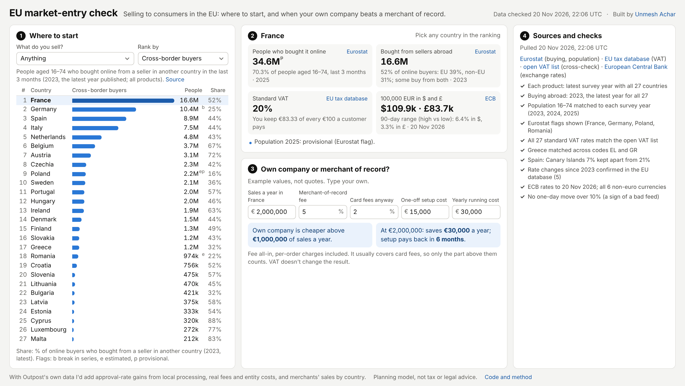

# EU market-entry check

A one-screen dashboard for an online business deciding where to start selling to consumers in the EU, and whether its own company or a merchant of record is cheaper there. It pulls official public data every day, checks it, and publishes the page.

**Live page:** https://unmesh30.github.io/eu-market-entry-check/



## What it shows

1. **Where to start.** The 27 EU countries ranked three ways:
   - **Cross-border buyers**: how many people aged 16–74 bought online from a seller in another country in the last 3 months. This is the market a cross-border seller can reach today. France comes first, ahead of Germany, although Germany has more online shoppers.
   - **People who bought it**: how many people bought what you sell online in the last 3 months (ten product choices, from clothes to app subscriptions).
   - **Cross-border share**: the share of online buyers who already buy from other countries.

   Counts are Eurostat's survey share times the population aged 16–74 in the same year.
2. **Country detail.** Buyers; buying from abroad, split into EU and non-EU; the standard VAT rate, what you keep of every €100 a customer pays, and the latest confirmed change to the rate; what 100,000 in the local currency is worth in dollars and pounds, and its 90-day range from high to low.
3. **Own company or merchant of record.** You enter your sales in that country, the merchant-of-record fee, the card fees you would pay anyway, and the setup and running costs of your own company. It shows the sales level where your own company becomes cheaper, and how long its setup takes to pay back. No costs are guessed: the inputs start at example values labelled as such.
4. **Sources and checks.** Where every number comes from, and the checks it passed that day.

Links such as `#c=ES&p=clothes` open the page on a given country and product.

## Where the data comes from

| Data | Source | Changes |
|---|---|---|
| Online buying, by product and from abroad | Eurostat household survey: `isoc_ec_ib20`, `isoc_ec_ibgs`, `isoc_ec_ibos` | yearly |
| Population aged 16–74 | Eurostat `demo_pjan` | yearly |
| Standard VAT rates and recent changes | European Commission, Taxes in Europe Database (TEDB), VAT retrieval service | when a rate changes |
| VAT cross-check | [ibericode/vat-rates](https://github.com/ibericode/vat-rates) | when a rate changes |
| Exchange rates | European Central Bank euro reference rates, last 90 days | every working day |

All of them are public and free, and none needs a login or an API key.

## Checks before anything is published

- **VAT.** The EU database and the open list must agree on all 27 standard rates. The EU database is not uniform, and the first live run stopped on it:
  - several countries' main rate carries a legal reference in its comment (Belgium, Czechia, France, Ireland, Latvia, Luxembourg);
  - some countries have extra entries labelled `VAT - <name>`: Spain's 7% for the Canary Islands, and a 19% "Import" entry for Germany.

  The main rate is the one without such a label, and there must be exactly one. Labelled entries are shown only when their rate differs (the Canary Islands). Greece is matched across its two codes (EL and GR). A rate change is dated from the standard rate only, because the open list also starts a new period when just a reduced rate changes (Finland, January 2026). It is shown only after the EU database confirms the old rate on the day before and the new rate on the day itself.
- **Eurostat.** Each product uses its latest survey year that covers all 27 countries, so a gap is never read as zero. Population is taken for the same year as each survey, and Eurostat's flags (estimated, provisional) are shown next to the numbers they apply to. Buying from abroad must be at least as common among online buyers as among all people, which catches a mix-up of units.
- **Exchange rates.** The newest rates must be at most 7 days old, all six non-euro EU currencies must be present, and no currency may move more than 10% in a day.
- **If a source fails,** the page keeps that source's last good data and says so on screen, and the day's run is marked as failed so it gets noticed.

## How it runs

A GitHub Actions workflow runs every day at 16:41 UTC, after the ECB publishes. It runs `python -m pipeline.build`, saves the day's data to `data/latest.json` (the git history is the daily record), and deploys the page to GitHub Pages. The tests run whenever the code changes. The pipeline uses only Python's standard library.

```bash
python -m pipeline.build --data data/latest.json --out site   # pulls live data
pip install -r requirements-dev.txt && python -m pytest        # tests use a simulated copy of each source, no internet
```

## Layout

```
pipeline/eurostat.py   online buying, buying from abroad, population
pipeline/vat.py        EU tax database, open-list cross-check, rate changes
pipeline/fx.py         ECB rates, values in USD and GBP, 90-day range
pipeline/build.py      runs every source, falls back to last good data, builds the page
site_src/index.html    the page (data is embedded at build time)
site_src/calc.js       the own-company vs merchant-of-record arithmetic, tested as shipped
tests/                 tests for every parser, check and the calculator
```

## Limits

- Consumer sales only: the survey covers people, not businesses.
- EU-27 only: the UK and other non-EU markets are not in these EU sources.
- Buying from abroad comes from 2023, the latest year Eurostat publishes for all 27 countries, and is not split by product.
- A planning model, not tax or legal advice.

Built by [Unmesh Achar](https://www.linkedin.com/in/unmesh-achar-319467210/). MIT licence.
